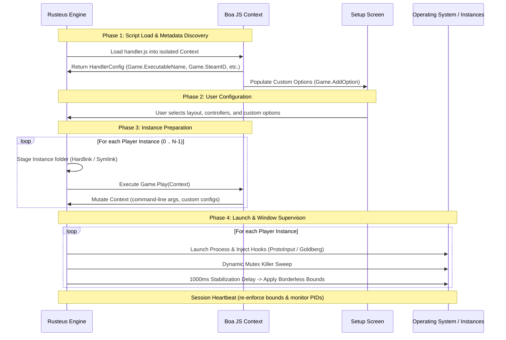

# SplitscreenMe Handler Developer Guide & JavaScript API Specification

Welcome to the definitive guide for authoring game handlers for **Rusteus-Coop** and SplitscreenMe. A handler is a JavaScript (`.js`) file that instructs the engine on how to stage, launch, hook, partition, and isolate multiple instances of a game.

Rusteus-Coop provides **100% backward compatibility** with legacy SplitscreenMe handlers while exposing powerful modern capabilities (AutoHotkey scripting, Ludusavi savegame isolation, WASM plugins, and live OSD Drop-In).

---

## 1. Handler Lifecycle & Execution Architecture

A game handler undergoes four distinct execution phases during a session:



---

## 2. Global JavaScript API Reference

### 2.1 The `Game` Object (Configuration)

The global `Game` object defines static handler properties.

#### Identification & Basic Settings
| Property | Type | Default | Description |
|---|---|---|---|
| `Game.GUID` | `string` | `""` | Unique identifier for the handler. |
| `Game.GameName` | `string` | `""` | Display name of the game in the UI. |
| `Game.SteamID` | `string` | `""` | Steam App ID (used for Goldberg emulator and cover art). |
| `Game.MaxPlayers` | `number` | `4` | Maximum players supported across all displays. |
| `Game.MaxPlayersOneMonitor` | `number` | `4` | Maximum players supported on a single physical display. |
| `Game.ExecutableName` | `string` | `""` | Primary executable name (e.g. `"left4dead2.exe"`). |
| `Game.ExecutableNames` | `string[]` | `[]` | Alternative executable names to recognize. |
| `Game.BinariesFolder` | `string` | `""` | Subfolder where binary files reside relative to root (e.g. `"bin/win64"`). |
| `Game.WorkingFolder` | `string` | `""` | Working directory for the process if different from binary directory. |
| `Game.LauncherExe` | `string` | `""` | Separate launcher executable if the game launches via a secondary binary. |
| `Game.LauncherTitle` | `string` | `""` | Window title of the launcher to detect. |
| `Game.PauseBetweenStarts` | `number` | `1000` | Delay in milliseconds between launching consecutive instances. |

#### Filesystem Staging & Sandbox
| Property | Type | Default | Description |
|---|---|---|---|
| `Game.SymlinkGame` | `boolean` | `true` | Symlink/hardlink game files into instance folders. |
| `Game.SymlinkFolders` | `boolean` | `false` | Create directory junctions (`mklink /J`) for top-level directories. |
| `Game.HardcopyGame` | `boolean` | `false` | Force a complete physical file copy of all game files (slow!). |
| `Game.HardlinkGame` | `boolean` | `false` | Explicitly request NTFS hardlinks. *(Note: Rusteus automatically falls back to hardlinks if symlinks fail!)* |
| `Game.DirSymlinkExclusions` | `string[]` | `[]` | Directories that must NOT be linked or copied. |
| `Game.FileSymlinkExclusions` | `string[]` | `[]` | Files that must NOT be linked (e.g. config files created fresh). |
| `Game.FileSymlinkCopyInstead` | `string[]` | `[]` | Files that must be physically copied per-instance rather than linked. |
| `Game.DirSymlinkCopyInstead` | `string[]` | `[]` | Folders that must be physically copied per-instance. |
| `Game.KeepSymlinkOnExit` | `boolean` | `false` | Keep staged instance folders on disk when session ends. |

#### Window Geometry & Borderless Styling
| Property | Type | Default | Description |
|---|---|---|---|
| `Game.SupportsPositioning` | `boolean` | `true` | Whether Rusteus should reposition and tile the game window. |
| `Game.KeepAspectRatio` | `boolean` | `false` | Maintain aspect ratio (letterboxing/pillarboxing) inside viewport. |
| `Game.DontResize` | `boolean` | `false` | Do not alter game window dimensions (positioning only). |
| `Game.DontReposition` | `boolean` | `false` | Do not alter window position coordinates. |
| `Game.NotTopMost` | `boolean` | `false` | Do not enforce topmost window state. |
| `Game.SetTopMostAtEnd` | `boolean` | `false` | Force topmost state on all instances only after all finish launching. |
| `Game.HideTaskbar` | `boolean` | `false` | Hide the Windows taskbar during active gameplay. |
| `Game.LockMouse` | `boolean` | `false` | Lock the mouse cursor within the active window boundaries. |

#### Singleton Mutex Killer
| Property | Type | Default | Description |
|---|---|---|---|
| `Game.KillMutex` | `string[]` | `[]` | Array of mutex/mutant names to terminate in the game process. |
| `Game.KillMutexType` | `string` | `"Mutant"` | Win32 object type to search (default `"Mutant"`). |
| `Game.KillMutexDelay` | `number` | `0` | Delay in milliseconds before terminating the mutex. |
| `Game.PauseBeforeMutexKilling` | `number` | `0` | Delay after process launch before beginning handle search. |
| `Game.PartialMutexSearch` | `boolean` | `false` | Match mutex names using substring matching instead of exact equality. |

#### Input & Controller Hooks
| Property | Type | Default | Description |
|---|---|---|---|
| `Game.SupportsKeyboard` | `boolean` | `false` | Allow one player to use the primary keyboard and mouse. |
| `Game.KeyboardPlayerFirst` | `boolean` | `false` | Automatically assign the keyboard player to Player Slot 0. |
| `Game.SupportsMultipleKeyboardsAndMice` | `boolean` | `false` | Support multiple keyboards/mice concurrently (via ProtoInput). |
| `Game.SupportsXInput` | `boolean` | `true` | Game supports Xbox / XInput controllers. |
| `Game.SupportsDInput` | `boolean` | `false` | Game supports DirectInput controllers. |
| `Game.Hook.XInputEnabled` | `boolean` | `true` | Enable XInput controller hook staging. |
| `Game.Hook.XInputReroute` | `boolean` | `false` | Intercept and reroute XInput DLL calls. |
| `Game.Hook.SDL2Enabled` | `boolean` | `false` | Deploy custom `SDL2.dll` controller mapping. |
| `Game.UseProtoInput` | `boolean` | `false` | Enable ProtoInput raw input hooks. |
| `Game.ProtoInput.XinputHook` | `boolean` | `false` | Hook XInput inside ProtoInput. |
| `Game.ProtoInput.DinputHook` | `boolean` | `false` | Hook DirectInput inside ProtoInput. |
| `Game.ProtoInput.FocusFilter` | `boolean` | `false` | Intercept focus loss messages in target process. |

#### Emulation & Tool Integrations
| Property | Type | Default | Description |
|---|---|---|---|
| `Game.UseGoldberg` | `boolean` | `false` | Deploy Goldberg Steam Emulator to emulate Steam multiplayer. |
| `Game.GoldbergLanguage` | `string` | `"english"` | Language passed to Goldberg emulator. |
| `Game.UseNemirtingasEpicEmu` | `boolean` | `false` | Deploy Nemirtingas Epic Games emulator. |
| `Game.UseNemirtingasGalaxyEmu` | `boolean` | `false` | Deploy Nemirtingas GOG Galaxy emulator. |
| `Game.UseX360ce` | `boolean` | `false` | Deploy x360ce controller wrapper DLLs. |
| `Game.UseDevReorder` | `boolean` | `false` | Deploy DevReorder `dinput8.dll` to reorder DirectInput gamepads. |
| `Game.UseForceBindIP` | `boolean` | `false` | Bind instances to virtual loopback adapters (`127.0.0.X`). |

---

### 2.2 Modern Rusteus-Coop API Additions

Rusteus-Coop introduces native support for several advanced subsystems:

#### 1. Native AutoHotkey Integration
Handlers can now execute AutoHotkey scripts at distinct lifecycle checkpoints:
```javascript
Game.UseAutoHotkey = true;
Game.AutoHotkeyTiming = Nucleus.AhkTiming.PostWindow; // PreLaunch | PostLaunch | PostWindow | Teardown
Game.AutoHotkeyCode = `
    WinWaitActive, ahk_pid %NUCLEUS_PID%
    Send, {F11}
`;
```
Every script execution automatically receives environment parameters:
`NUCLEUS_PLAYER_INDEX`, `NUCLEUS_PID`, `NUCLEUS_HWND`, `NUCLEUS_POS_X`, `NUCLEUS_POS_Y`, `NUCLEUS_WIDTH`, `NUCLEUS_HEIGHT`.

#### 2. Ludusavi Savegame Isolation
Isolate player campaign saves automatically using Ludusavi without writing manual file copying scripts:
```javascript
Game.LudusaviTitle = "Left 4 Dead 2"; // Match Ludusavi manifest title
Game.LudusaviPaths = ["SaveRoot/PlayerSave"];
```

#### 3. Custom UI Options (`Game.AddOption`)
Create interactive configuration questions displayed in the setup screen:
```javascript
Game.AddOption(
    "Network Mode",                     // Title
    "Choose multiplayer connection",    // Description
    "net_mode",                         // Key stored in Context.Options
    ["Offline / LAN", "Direct Connect", "Lobby Emulation"] // Values
);
```

#### 4. Arbitrary DLL Injection & Remote Export Execution
Inject custom `.dll` mods or helper binaries into specific instances at exact lifecycle stages without external injector tools:
```javascript
Game.InjectedDlls = [
    {
        Path: "mods/early_patch.dll",
        Timing: "AtStartupSuspended", // Spawns suspended, injects, calls export, resumes
        Required: true,
        TargetInstances: "All",
        ExportName: "InitPatch",
        ExportArgument: "disable_intro=1"
    },
    {
        Path: "mods/fov_fix.dll",
        Timing: "OnWindowCreated",   // Injects once HWND is created & bounds applied
        DelayMs: 250,
        TargetInstances: "All",
        ExportName: "SetFieldOfView",
        ExportArgument: "95",
        EjectOnClose: true           // Cleanly calls FreeLibrary on session shutdown
    }
];

// Or programmatically via helper:
Game.AddInjectedDll("mods/extra_mod.dll", {
    Timing: "PostStartup",
    TargetInstances: [0, 1]
});
```

#### 5. Cheat Engine Parity Memory Manipulation
Completely replaces the need for manual Cheat Engine workflows. Handlers can scan signatures (AOB with wildcards), traverse multi-level pointer chains, and freeze memory values continuously across instances:
```javascript
Game.Play = function() {
    // 1. AOB pattern scanning with wildcard masks:
    var matches = Context.ScanMemory("89 45 ?? 8B 45", "xx?xx", null);
    if (matches && matches.length > 0) {
        var instructionAddr = matches[0];
        // Patch instructions directly (e.g. NOP out damage calculation)
        Context.WriteMemoryBytes(instructionAddr, [0x90, 0x90, 0x90, 0x90, 0x90]);
    }

    // 2. Multi-level pointer chain resolution:
    var baseModuleAddr = 0x00400000;
    var playerHealthAddr = Context.ResolvePointer(baseModuleAddr, [0x48, 0x1C, 0x30]);

    // 3. Continuous memory freezing (Cheat Engine locked values):
    // Frozen values are automatically enforced every 500ms by the session heartbeat loop
    var freezeId = Context.FreezeMemoryInt(playerHealthAddr, 9999);
};
```

#### 6. Bidirectional Inter-Process Communication (IPC)
Communicate with injected DLLs in real time via Windows Named Pipes or Shared Memory:
```javascript
Context.SendDllMessage(JSON.stringify({
    command: "SetPlayerNickname",
    nickname: Context.Nickname,
    instanceIndex: Context.InstanceNum,
    viewport: { x: Context.PosX, y: Context.PosY, width: Context.Width, height: Context.Height }
}));
```
Automatic environment telemetry variables provided to all instance processes:
- `NUCLEUS_INSTANCE_INDEX`: Zero-indexed instance index (`"0"`, `"1"`, etc.).
- `NUCLEUS_PLAYER_INDEX`: Zero-indexed player index.
- `NUCLEUS_PLAYER_ID`: One-indexed player number (`"1"`, `"2"`, etc.).
- `NUCLEUS_PIPE_NAME`: `\\.\pipe\nucleus_instance_{index}`.
- `NUCLEUS_SHARED_MEM_NAME`: `Local\nucleus_instance_{index}`.

---

### 2.3 The Runtime `Context` Object

When `Game.Play = function() { ... }` executes for each player instance, the engine passes a `Context` object containing active instance geometry and file paths:

| Property / Method | Return Type | Description |
|---|---|---|
| `Context.InstanceNum` | `number` | Zero-indexed player index (0 for Player 1, 1 for Player 2, etc.). |
| `Context.PlayerID` | `number` | Same as `InstanceNum`. |
| `Context.Width` | `number` | Computed viewport width in pixels. |
| `Context.Height` | `number` | Computed viewport height in pixels. |
| `Context.PosX` | `number` | X coordinate of the top-left corner of the assigned viewport. |
| `Context.PosY` | `number` | Y coordinate of the top-left corner of the assigned viewport. |
| `Context.StartArguments` | `string` | Command-line arguments passed to the executable (can be appended to). |
| `Context.Options[key]` | `string` | User's selected value from `Game.AddOption`. |
| `Context.IsKeyboardPlayer` | `boolean` | True if this instance was assigned keyboard and mouse. |
| `Context.WriteTextFile(path, text)` | `void` | Writes or overwrites a text file at `path` (relative or absolute). |
| `Context.ReadTextFile(path)` | `string` | Reads text contents from a file. |
| `Context.CopyFolder(src, dest)` | `void` | Recursively copies a folder from `src` to `dest`. |
| `Context.InjectDll(path, options)` | `number` | Injects a DLL into the running instance process; returns remote module handle. |
| `Context.CallDllExport(module, export, arg)` | `number` | Executes an exported function in an injected DLL via remote thread. |
| `Context.SendDllMessage(json)` | `boolean` | Transmits a length-prefixed JSON message to the instance Named Pipe. |
| `Context.ReadMemoryInt(address)` | `number` | Reads a 32-bit signed integer from target process memory. |
| `Context.ReadMemoryFloat(address)` | `number` | Reads a 32-bit floating-point value from target process memory. |
| `Context.ReadMemoryBytes(address, length)` | `number[]` | Reads an array of bytes from target process memory. |
| `Context.WriteMemoryInt(address, value)` | `boolean` | Writes an integer into target process memory (with auto-unprotect). |
| `Context.WriteMemoryFloat(address, value)` | `boolean` | Writes a float into target process memory. |
| `Context.WriteMemoryBytes(address, bytes)` | `boolean` | Writes a byte array into target process memory. |
| `Context.ScanMemory(pattern, mask, module)` | `number[]` | Performs fast AOB signature search (Cheat Engine style); returns array of matched addresses. |
| `Context.ResolvePointer(base, offsets)` | `number` | Traverses multi-level pointer chains to resolve final address. |
| `Context.FreezeMemoryInt(address, value)` | `number` | Registers a continuous memory freeze rule (re-asserted every 500ms); returns freeze ID. |
| `Context.UnfreezeMemory(freezeId)` | `boolean` | Unfreezes and removes a continuous memory freeze rule. |

`Context` also mirrors every non-function `Game` property (`Context.SymlinkExe`, `Context.Hook`, `Context.GameName`, ...), as in the original application.

### 2.4 Original-API Compatibility Members

These members exist so handlers written for the original Nucleus Co-op run unchanged.

#### `Context` properties

| Property | Description |
|---|---|
| `Arch` | `"x86"` or `"x64"`, from the game executable. |
| `PlayerSteamID`, `PlayerSteamIDs` | SteamID64 of this player / of every player. Uses `Game.PlayerSteamIDs` when `Game.UseHandlerSteamIds` is set. |
| `UserName` | Windows account name. |
| `NucleusFolder`, `UtilFolder`, `HandlersFolder`, `ScriptFolder` | Install root, `utils`, the handlers folder, and the handler's companion folder (`handlers\<script name>`). |
| `NucleusUserRoot`, `NucleusEnvironmentRoot`, `NucleusDocumentsRoot` | User profile and Documents roots. |
| `EnvironmentRoot`, `EnvironmentPlayer`, `DocumentsRoot`, `DocumentsPlayer` | Per-session and per-player Nucleus environment folders (trailing separator included). |
| `PlayerGameFilesBackupFolder` | Per-player backup folder for game files. |
| `HasKeyboardPlayer`, `NumControllers`, `NumKeyboards` | Session input summary. |
| `GamepadGuid`, `x360ceGamepadGuid`, `RawHID` | Identity of the assigned gamepad. |
| `OrigAspectRatio`, `OrigAspectRatioDecimal`, `IsFullscreen` | Monitor aspect ratio and whether the instance fills its monitor. |
| `SteamLang`, `EpicLang`, `GogLang` | Store language names. |
| `UserProfileConfigPath`, `UserProfileSavePath`, `DocumentsConfigPath`, `DocumentsSavePath` | Readable and writable from `Game.Play`. |
| `KeepEditedRegKeys` | Set to `true` to keep registry edits after the session (they are restored otherwise). |

#### `Context` methods

| Method | Description |
|---|---|
| `EditRegKey(base, key, name, value, Nucleus.RegType.X)` | Sets a registry value, exporting the key to `utils\backup` first. `EditRegKeyNoBackup` skips the export. |
| `ReadRegKey(base, key, name)` | Returns the value as a string, or `null`. |
| `CreateRegKey`, `DeleteRegKey`, `DeleteRegKeyValues` | Registry key management. `base` is `HKEY_CURRENT_USER`, `HKEY_LOCAL_MACHINE` or `HKEY_USERS`. |
| `FindFiles(root, pattern[, searchAll])` | Files matching a `*`/`?` pattern. |
| `FindFilePartialName(root, names)` | Paths under `root` containing any of `names`. |
| `SearchSubFolder(parent, text)` / `SearchSubFolders` | First / all sub-folders whose path contains `text`. |
| `CopyFolder(src, dest)`, `CopyScriptFolder(dest)`, `MoveFolder(from, to)` | Folder operations (`MoveFolder` is relative to the instance folder). |
| `BackupFile(path or paths, overwrite)` | Writes `<name>_NUCLEUS_BACKUP<ext>` next to the file. |
| `ProceedSymlink()` | Links every file in `Game.SymlinkFiles` into the instance folder. |
| `HexEdit(file, hexAddress, bytes)` | Writes bytes at an offset. |
| `ReplacePartialLinesInTextFile(path, ["line\|regex\|replacement"][, encoding])` | Regex replace inside given lines. |
| `EditTextFile(path, refLines, newLines, encoding)` | Replaces (or, with `"Delete"`, removes) every line containing a reference string. |
| `ExtractZip(zip, dest, password)`, `EditZipFile(zip, password, savePath, add, remove)` | Zip handling. |
| `ModifiedDate(file, y, m, d[, h, mi, s])`, `CreatedDate(...)` | Sets file timestamps (local time). |
| `StartProcess(path, args, asAdmin)`, `RunAdditionalFiles(files, changeWorkingDir, secondsBetween)` | Starts helper programs. |
| `KillProcessesMatchingProcessName(text)`, `KillProcessesMatchingWindowName(text)` | Ends matching processes. |
| `SetProtoInputMultipleControllers(c1, c2, c3, c4)` | Assigns up to four pads to this instance (with `Game.ProtoInput.MultipleProtoControllers`). |
| `HideDesktop([hideTaskbar])`, `HideTaskBar()` | Honoured for the first player. |
| `RandomString(n[, lower])`, `ConvertToString`, `ToUpperCase`, `ToLowerCase`, `GetFileName`, `NewSaveInfo`, `Wait(ms)` | Helpers. |

#### `Game` properties

| Property | Format | Effect |
|---|---|---|
| `CopyFoldersTo`, `SymlinkFoldersTo`, `HardlinkFoldersTo` | `"source\|destination"` | Places a game folder inside each instance. |
| `RenameAndOrMoveFiles` | `"[instance\|]from\|to"` | Renames/moves a file inside the instance. |
| `DeleteFiles` | `"[instance\|]file"` | Deletes a file from the instance (asks first unless `IgnoreDeleteFilesPrompt`). |
| `CopyCustomUtils` | `"name[\|destination[\|instances]]"` | Copies a file or folder from `utils\User`. |
| `HexEditExe`, `HexEditFile` | one `"find\|replace"` / `"file\|find\|replace"` entry **per player** | ASCII patch of the first match. |
| `HexEditAllExes`, `HexEditAllFiles` | `"find\|replace"` / `"file\|find\|replace"` | Same, for every instance. |
| `HexEditExeAddress`, `HexEditFileAddress` | `"[instance\|]address\|hexBytes"` / `"[instance\|]file\|address\|hexBytes"` | Writes bytes at an offset. |
| `SymlinkFiles` | relative paths | Linked by `Context.ProceedSymlink()`. |
| `UseHandlerSteamIds`, `PlayerSteamIDs` | | Fixed Steam IDs per player. |
| `XInputPlusNoIni`, `XInputPlusOldDll`, `UseDInputBlocker` | | Tool deployment variants. |
| `OnStop` | function | Called when the session ends. |

Hex edits always operate on a private copy of the file: an instance file that is a symlink or hardlink into the installed game is detached first, so the installation is never modified.

#### `Game.ProtoInput`

Every option of the original `ProtoInputOptions` block is read (`InjectStartup`, `InjectRuntime_*Method`, the `*Hook` and `*Filter` switches, `Send*Messages`, the `FocusLoop_*` set, `DrawFakeCursor`, `RenameHandles`, `BlockedMessages`, `MultipleProtoControllers`, ...). Enum-typed options (`SetWindowPosHook`, `MoveWindowHook`, `SetRemoveBorderHook`, `DrawFakeCursor`, `PutMouseInsideWindow`) accept `true`, a number, or the member name.

Handlers can also adjust ProtoInput at runtime from `Game.ProtoInput.OnInputLocked`, `Game.ProtoInput.OnInputUnlocked` and `Game.OnFinishedSetup`, using the global `ProtoInput` object (`InstallHook`, `UninstallHook`, `EnableMessageFilter`, `DisableMessageFilter`, `EnableMessageBlock`, `DisableMessageBlock`, `SetDrawFakeCursor`, `SetDrawFakeCursorFix`, `SetRawInputBypass`, `StartFocusMessageLoop`, `StopFocusMessageLoop`, and the `ProtoInput.Values.*HookID` / `*FilterID` constants) and the `PlayerList` collection (`PlayerList.Count`, `PlayerList[i].ProtoInputInstanceHandle`, `IsKeyboardPlayer`, `ProtoController1..4`, ...). The callbacks are evaluated once per instance right after `Game.Play`; the operations they request (including `System.Threading.Thread.Sleep` pauses) are recorded and replayed on the running instances each time the event occurs. A callback therefore must not depend on state that changes after setup.

The .NET-style helpers handlers commonly call are available: `System.Threading.Thread.Sleep`, `System.Environment.UserName` / `GetEnvironmentVariable`, `System.IO.Path` (`Combine`, `GetDirectoryName`, `GetFileName`, `GetExtension`, `GetFileNameWithoutExtension`), `System.IO.File` (`Exists`, `Copy`, `Delete`, `Move`, `ReadAllText`, `ReadAllLines`, `WriteAllText`, `WriteAllLines`, `AppendAllText`) and `System.IO.Directory` (`GetFiles`, `GetDirectories`, `GetParent`).

#### Translation, scaling and other newer ProtoInput options

`TranslateXinputtoMKB` (with the `TranslateX*` bindings and switches), `TranslateMKBtoXinput`, `ReRegisterInput`, `PointerInMouse`, `MessageSubWindows`, `GetCursorInfoHook`, `SetWindowsHookHook` and `ScaleFromX` / `ScaleFromY` are read and applied. They rely on functions only newer ProtoInput builds export; with an older build the launcher logs which option is unsupported and continues.

#### Settings of the original hook DLL

Handlers that predate ProtoInput configure input isolation with `Game.SetWindowHook`, `Game.SetWindowHookStart`, `Game.HookInit`, `Game.HookFilterRawInput`, `Game.HookFilterMouseMessages`, `Game.HookGetCursorPos` (and the other `Hook*` switches), `Game.SendNormalMouseInput`, `Game.SendNormalKeyboardInput`, `Game.SendScrollWheel`, `Game.DrawFakeMouseCursor`, `Game.BlockRawInput`, `Game.InjectHookXinput` and `Game.PreventWindowDeactivation`. The original hook DLL is not part of this project. When a handler uses these and does not set any `Game.ProtoInput.Inject*` option itself, the launcher derives the equivalent ProtoInput configuration (startup injection when `HookInit`, `SetWindowHookStart` or `BlockRawInput` is set, runtime injection otherwise). This is an equivalence, not the original implementation, so behaviour can differ in details. If ProtoInput is not installed such a handler still starts, without the hooks, and says so on screen.

#### Input lock

`Game.LockInputAtStart` locks input to the instances as soon as setup finishes (when ProtoInput is active). `Game.LockInputSuspendsExplorer` suspends the Windows shell while locked; it is resumed on unlock and whenever the session ends. `Game.KeyboardPlayerSkipFakeFocus` is honoured.

#### Other launch settings

| Setting | Effect |
|---|---|
| `LaunchAsDifferentUsers` | Each instance runs as its own local Windows account `nucleusplayerN`. The accounts are created on first use, which requires running the launcher as administrator once. |
| `CustomUserGeneralPrompts`, `CustomUserPlayerPrompts`, `CustomUserInstancePrompts` | The user is asked for each value before `Game.Play`; answers are available as `Context.CustomUserGeneralValues` etc. `SaveCustomUser*Values` reuses stored answers, `SaveAndEditCustomUser*Values` offers them as defaults. |
| `NeedsSteamEmulation`, `SSEAdditionalLines` | Deploys SmartSteamEmu and starts the instance through its loader (when Goldberg is not used). |
| `GamePlayBeforeGameSetup` | Runs `Game.Play` before emulators and input tools are deployed. |
| `ForceUserProfileConfigCopy`, `ForceUserProfileSaveCopy`, `ForceDocumentsConfigCopy`, `ForceDocumentsSaveCopy`, `*NoCopy`, `ForceEnvironmentUse` | Control whether profile folders are copied into the per-player environment and whether they are refreshed on every launch. |

Not implemented: `CustomHotkeys` / `OnCustomHotKey_N`, `ChangeIPPerInstance`, `UseDI8CoopLvlUnlocker`, `UseGoldbergNoOGSteamDlls`, `TransferNucleusUserAccountProfiles`, `ToggleUnfocusOnInputsLock`. These are parsed and ignored.

When a handler requests injection, the launcher starts the game through ProtoInput (`InjectStartup`) or injects the running process, then selects the keyboard, mouse and controllers assigned to that player. The ProtoInput DLLs are not part of this repository: copy the files from a [ProtoInput release](https://github.com/SplitScreen-Me/ProtoInput) next to `nucleus-coop.exe` (or into `utils\ProtoInput`). Launching a handler that needs them without them stops with a message naming the missing files.

---

## 3. Production Handler Templates

### Template 1: Standard Steam Game (Goldberg LAN Emulation)

```javascript
Game.GUID = "my-steam-coop-game";
Game.GameName = "My Steam Co-op Game";
Game.SteamID = "1234560";
Game.MaxPlayers = 4;
Game.MaxPlayersOneMonitor = 4;
Game.ExecutableName = "game.exe";

Game.SymlinkGame = true;
Game.UseGoldberg = true;
Game.GoldbergLanguage = "english";
Game.KillMutex = ["MyGame_Singleton_Mutex"];

Game.Play = function() {
    // Append window dimensions to launch arguments
    Context.StartArguments += " -windowed -noborder -width " + Context.Width + " -height " + Context.Height;
};
```

### Template 2: ProtoInput Multiple Keyboard & Mouse Game

```javascript
Game.GUID = "protoinput-shooter";
Game.GameName = "Dual Keyboard & Mouse Shooter";
Game.MaxPlayers = 2;
Game.ExecutableName = "shooter.exe";

Game.SupportsMultipleKeyboardsAndMice = true;
Game.UseProtoInput = true;
Game.ProtoInput.XinputHook = true;
Game.ProtoInput.FocusFilter = true;

Game.Play = function() {
    Context.StartArguments += " -popupwindow -x " + Context.PosX + " -y " + Context.PosY;
};
```

### Template 3: Arbitrary DLL Injection & Cheat Engine Memory Patching

```javascript
Game.GUID = "custom-mod-cheat-engine-game";
Game.GameName = "Custom Mod & In-Process Memory Patch Game";
Game.MaxPlayers = 4;
Game.ExecutableName = "game.exe";

// Early DLL injection at process startup suspended
Game.InjectedDlls = [
    {
        Path: "mods/fov_fix.dll",
        Timing: "AtStartupSuspended",
        Required: true,
        ExportName: "SetFov",
        ExportArgument: "105",
        EjectOnClose: true
    }
];

Game.Play = function() {
    // 1. Signature scan to locate damage calculation instruction
    var matches = Context.ScanMemory("89 45 ?? 8B 45", "xx?xx", null);
    if (matches && matches.length > 0) {
        // NOP out the instruction: 5 bytes of 0x90
        Context.WriteMemoryBytes(matches[0], [0x90, 0x90, 0x90, 0x90, 0x90]);
    }

    // 2. Resolve pointer chain and freeze max player health
    var baseModuleAddr = 0x00400000;
    var playerHealthAddr = Context.ResolvePointer(baseModuleAddr, [0x48, 0x1C, 0x30]);
    if (playerHealthAddr !== 0) {
        // Automatically re-asserted on every 500ms engine heartbeat tick
        Context.FreezeMemoryInt(playerHealthAddr, 9999);
    }
};
```

---

## 4. Key Differences & Behavioral Divergence: C# vs Rust

When porting or writing handlers for Rusteus-Coop, note these critical differences:

1. **Strict Path Resolution**:
   - In legacy C#, some path methods accepted ill-formed paths or assumed Windows root paths.
   - In Rusteus, relative paths in `Context.WriteTextFile` are strictly resolved relative to the instance staging directory (`./content/<Game>/Instance<N>/`).
2. **Strict Boolean & Numeric Handling (Boa Engine)**:
   - Boa (v0.20) adheres strictly to ECMAScript 2020 standards. Avoid relying on .NET CLR type coercion (e.g. comparing string `"0"` with boolean `false`).
3. **Loopback IP Formula**:
   - Legacy Nucleus used `127.0.0.1` for Instance 0, causing localhost socket collisions with local Steam and host daemons.
   - Rusteus strictly allocates loopback IPs starting at `127.0.0.2`:
     $$\text{IP} = 127.0.0.(i + 2)$$
     Instance 0 gets `127.0.0.2`, Instance 1 gets `127.0.0.3`.
4. **1000ms Stabilization Delay**:
   - Rusteus introduces a guaranteed 1000ms settling delay between HWND discovery and window border removal. Handlers no longer need to add artificial `sleep` or `pause` commands to prevent Direct3D window reset glitches.
